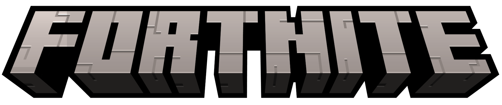

<p align="center">
  
</p>

# Ping

Fortnite's ping system, rebuilt for Minecraft as a client-side mod.

Right-click-free marking: aim at something, tap the ping key, and a marker appears
where you are looking, red and tracking if it is an enemy, showing the item if it is
loot, a plain location pin otherwise. Off-screen markers clamp to the edge of the view
so you always know which way to turn, and every marker carries its distance in metres.

There is a minimap in the corner and a full-size map on `M`, and both show your markers,
or you can place one by pointing at the map instead of at the world.

Targets **Minecraft 26.2** on **Fabric**, Java 25.

## Controls

| Input | Action |
|---|---|
| Middle mouse (rebindable) | Ping what you are looking at |
| Middle mouse, twice quickly | Danger marker |
| `M` (rebindable) | Open the map |
| Left or middle click, on the map | Mark that spot |
| Double click, on the map | Danger marker |
| Scroll, on the map | Zoom |
| *unbound* | Toggle the minimap |

The first three are registered under *Options → Controls → Miscellaneous* as "Ping / Mark",
"Open map" and "Toggle minimap".

## What it does

- **Fortnite health and shield.** Two bars in the bottom-left, shield above health, with
  Fortnite's own glyphs and the current value beside each: the Chapter 7 design, drawn as
  bars rather than as recoloured Minecraft hearts. Minecraft's absorption fills the shield
  bar, which is the same rule Fortnite's shield follows: it is spent before health.
- **The ping feed, in chat.** "Zoey marked an enemy location", in Fortnite's own words,
  with each player's name in their marker colour. The feed *is* chat rather than a second
  widget beside it.
- **Named locations.** Right-click a banner to name the place it stands on. The name is
  drawn on the map at that spot, outlined so it reads over any terrain. Break the banner
  and the name goes with it. Kept per world in `config/ping-locations.json`, so a server's
  places and your singleplayer world's places never mix, and a name you type is only ever
  yours.
- **Smart ping.** What gets marked depends on the crosshair:
  - another player who is not an ally → **enemy** marker, red, and it follows them
  - a dropped item → **item** marker, attached to the item
  - ground, block or nothing → **location** marker
- **Marker lifetime.** Enemy and danger markers last 10 seconds and track their target for
  the first 5, then freeze where the target was last seen. Everything else lasts 45
  seconds: the one Fortnite duration with a measurement behind it.
- **A re-mark cooldown.** Pressing the mark button again straight away does nothing, as in
  Fortnite. The double tap that places a danger marker is exempt.
- **One marker per player.** Marking again moves your marker instead of stacking a
  second one, as in Fortnite.
- **Screen-space markers.** Projected through Minecraft's own camera matrix, so a
  marker lands exactly where you were aiming.
- **Off-screen carets.** Markers outside the view clamp to the viewport edge.
- **Author-coloured markers.** Each ping wears the marker colour of whoever placed it,
  specifically their Minecraft *locator bar* colour, derived from their UUID, so your
  ping is always the same colour as your pip on the locator bar.
- **The light beam.** A vertical light column stands at the marker, fading out towards
  the sky. It is a long-range signpost, so it fades in around 50 blocks and is gone when
  you are standing on the marker.
- **Distance readout** to the right of each marker, in metres.
- **Through-wall awareness.** A line-of-sight check dims markers behind terrain.
- **Pop-in, distance scaling, fade-out.**
- **Ping tones**, one per marker type.

## The map

A minimap sits in the top-right corner, and `M` opens the same map full-screen. It is drawn
from the world's own map colours, north-up, with your arrow turning instead of the map,
which is what Fortnite's does. Your markers appear on it in their author colours, item marks
keeping their item icon, and a marker outside the map's view sticks to the frame rather than
vanishing, so it still tells you which way to look. The full-size map adds a coordinate grid
and a zoom ladder on the scroll wheel.

**Marking from the map** works the way Fortnite's does: left click or middle click places a
marker on the column you point at, and a double click makes it a danger marker. The marker
lands on the ground there and then behaves exactly like one placed with the crosshair,
including travelling to other players running the mod.

The corner minimap is not clickable, and that is deliberate: while you are playing the
mouse belongs to the camera, so there is no cursor to click with. Fortnite works the same
way; you mark from the map.

## Multiplayer

Minecraft has no client-to-client channel: a modded client can only talk to the
server, and a vanilla server will not relay custom payloads. So pings travel over
chat, using a `#pp#` prefix and a small Base64 payload: type, position, and the
registry id of the item being marked. Every client running the mod spots the prefix,
cancels the line before it reaches the chat HUD, and turns it back into a marker.

That means **everyone who should see pings needs the mod**, and it works on any server
with nothing installed server-side. The trade-offs are that the server log records the
message, and players *without* the mod see a short line of junk.

### Turning it off

If nobody else in the world has the mod, sending is pure noise. There is a setting for
that:

```jsonc
// config/ping.json: written with defaults on first launch
{
  "sendPingsOverChat": true,
  "showMinimap": true,
  "fortniteHealth": true,
  "showPingFeed": true
}
```

Set it to `false` and pings become **entirely local**: nothing is sent, and chat stays
clean. Incoming pings are still decoded and hidden either way, so a modded teammate's
markers keep working regardless of this setting.

`showMinimap` hides the corner map. It is here as well as on the keybind because a HUD
preference that forgets itself on every restart is not a preference. The full-size map on
`M` is unaffected by it.

`fortniteHealth` swaps vanilla's hearts for Fortnite's health and shield meter: two bars in
the bottom-left, shield above health, with the game's own shield and health glyphs and the
current value beside each. Minecraft's absorption is what fills the shield bar; absorption
is spent before health, which is exactly Fortnite's rule, so the two agree without anything
being intercepted. Turn it off and vanilla's hearts come back immediately; the setting is
read every frame, not just at launch.

`showPingFeed` controls whether a ping writes a line into chat. The feed and chat are one
thing rather than two: Fortnite's Message Feed and Minecraft's chat do the same job in the
same corner, so a ping is a chat message and there is no second widget.

There is also an unbound keybind, **"Toggle ping chat sync"** (under *Miscellaneous*),
which flips the chat setting live and confirms the new state in the action bar, and a
second one for the minimap. Bind them if you want them to hand.

## Fonts and sounds

The real Fortnite marker sounds and icons are already in the mod: see
**[docs/ASSETS.md](docs/ASSETS.md)** for where they came from and how to swap in more.

## Building

```
./gradlew build
```

Runs in the dev client with:

```
./gradlew runClient
```

The built mod lands in `build/libs/ping-0.1.0.jar`.

## Not built yet

Roughly in order of how much they add to the look. The long version of this list, with
what is known about each and what is blocked, is **[docs/ROADMAP.md](docs/ROADMAP.md)**.

- **The radial wheel.** Holding the ping key should open Fortnite's communication
  wheel (Enemy Spotted / Going Here / Defend This / Need Ammo…). Currently only the
  singular smart ping and the double-tap danger marker exist.
- **The compass strip**, which is where markers (but not item marks) belong above the
  hotbar. `docs/FIDELITY.md` records the rule so it lands right when it is built.
- **A pannable map.** The full-size map is centred on you and zooms; Fortnite's can also
  be dragged, and its markers survive being marked from anywhere on it.
- **Marker depth against the world.** The beam is real world geometry and is occluded
  properly, but the pin and its label are HUD, so terrain in front of a pin does not hide
  it, only dim it.

---

## Disclaimer

Not affiliated with, endorsed by, or associated with Epic Games or Mojang. *Fortnite* is a
trademark of Epic Games, Inc. and *Minecraft* is a trademark of Mojang Studios. All
trademarks belong to their respective owners.

Made with **DeepSeek**. This mod was written with AI assistance from DeepSeek models.
